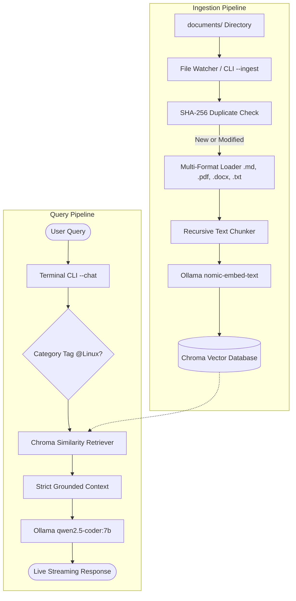

# Local RAG Cybersecurity Knowledge Base

[](https://www.python.org/)
[](https://www.langchain.com/)
[](https://www.trychroma.com/)
[](https://ollama.com/)
[](LICENSE)

A lightweight, local, offline-first **Retrieval-Augmented Generation (RAG)** knowledge assistant built specifically for cybersecurity domains (Linux privilege escalation, system hardening, OWASP Top 10, Docker security, and CTF tradecraft).

The system runs entirely on consumer hardware using local models via Ollama (`nomic-embed-text` for semantic vectors and `qwen2.5-coder:7b` for grounded response synthesis), guaranteeing that no proprietary or sensitive data leaves your machine.

---

## Architecture & Data Flow



---

## Core Capabilities

- **Offline-First & Private**: Local embedding generation and LLM inference. No OpenAI/cloud API keys required.
- **Incremental Indexing**: Uses SHA-256 content hashing to re-index only new or modified documents. Unchanged documents are skipped automatically.
- **Category Filtering**: Route questions to specific topic partitions using `@Category` syntax (e.g., `@Linux`, `@Docker`, `@OWASP`).
- **Live Ingestion Watcher**: Background daemon (`--watch`) that detects newly saved files in `documents/` and vectors them in real time.
- **Token Streaming**: Real-time streaming generation in your terminal for minimal perceived latency.
- **Evaluation Suite**: Built-in test harness (`tests/eval.py`) validating grounding accuracy and strict hallucination resistance against ungrounded queries.

---

## Repository Structure

```text
RAGsystem/
├── config/
│   └── settings.py          # Chunk size, overlap, model names, context window
├── documents/               # Curated cybersecurity knowledge library
│   ├── CTF/                 # Wi-Fi security, exploitation writeups
│   ├── Docker/              # Container security and hardening
│   ├── Linux/               # Privilege escalation & kernel hardening
│   └── OWASP/               # OWASP Top 10 vulnerability reference
├── src/
│   ├── benchmark.py         # Subsystem latency profiling
│   ├── chunker.py           # Document chunking logic
│   ├── embeddings.py        # Ollama embedding model interface
│   ├── generator.py         # Response generation with strict prompt constraints
│   ├── indexer.py           # Incremental hashing and indexing engine
│   ├── internet_fallback.py # Fallback search helper
│   ├── loader.py            # Multi-format document loader
│   ├── logger.py            # Logging utility
│   ├── retriever.py         # Vector similarity search with category filters
│   ├── vector_store.py      # ChromaDB interface
│   └── watcher.py           # Watchdog filesystem monitor
├── tests/
│   ├── eval.py              # Automated grounding and hallucination testing
│   ├── test_chunker.py      # Chunking unit tests
│   ├── test_loader.py       # Loader unit tests
│   ├── test_pipeline.py     # End-to-end pipeline verification
│   └── test_vector_store.py # Vector store insertion/query tests
├── main.py                  # Unified CLI entrypoint
├── requirements.txt         # Python dependencies
├── .flake8                  # Linting configuration
├── .gitignore               # Ignored runtime logs, caches, and vector DBs
├── LICENSE                  # MIT License
└── README.md                # Project documentation
```

---

## Installation & Setup

### 1. Prerequisites
- **Python 3.10+**
- **Ollama**: Download and install from [ollama.com](https://ollama.com/).

### 2. Pull Required Models
Make sure Ollama is running, then pull the default embedding and generator models:
```bash
ollama pull nomic-embed-text
ollama pull qwen2.5-coder:7b
```

### 3. Clone Repository & Install Dependencies
```bash
git clone https://github.com/ritikthakur22/RAGsystem.git
cd RAGsystem

python3 -m venv venv
source venv/bin/activate
# On Windows: venv\Scripts\activate

pip install -r requirements.txt
```

---

## CLI Usage

### 1. Ingest Knowledge Documents
Scan and index all markdown, text, PDF, and docx files in `documents/`:
```bash
python main.py --ingest
```
*Incremental indexing will automatically skip any files that haven't changed.*

### 2. Interactive Chat
Start an interactive terminal session with streaming output:
```bash
python main.py --chat
```

#### Category-Scoped Queries
Target specific categories by prefixing your prompt with `@CategoryName`:
```text
Ask: @Linux what are common sudo privilege escalation vectors?
Ask: @Docker how should daemon socket permissions be secured?
Ask: @OWASP explain broken access control mitigation strategies
```

### 3. Live File Watcher (Hot-Reload)
Run the watchdog daemon to automatically index files the moment you drop them into `documents/`:
```bash
python main.py --watch
```

### 4. Performance Benchmark
Profile document loading, chunking, embedding generation, Chroma insertion, retrieval, and LLM token generation:
```bash
python main.py --benchmark
```

---

## Configuration Reference

Key parameters can be adjusted in [`config/settings.py`](config/settings.py):

| Parameter | Default | Purpose |
| :--- | :--- | :--- |
| `CHUNK_SIZE` | `500` | Target characters per document chunk |
| `CHUNK_OVERLAP` | `100` | Character overlap between consecutive chunks |
| `TOP_K_RETRIEVAL` | `10` | Number of candidate context chunks retrieved |
| `EMBEDDING_MODEL` | `nomic-embed-text` | Ollama model used for vector representations |
| `GENERATION_MODEL`| `qwen2.5-coder:7b` | Ollama model used for answer synthesis |
| `CONTEXT_WINDOW` | `4096` | Context limit to constrain VRAM/RAM utilization |
| `TEMPERATURE` | `0.2` | Low temperature for strict factual adherence |

---

## Automated Evaluation & Tests

Run unit tests:
```bash
pytest tests/
```

Run the grounding and hallucination resistance suite:
```bash
python -m tests.eval
```

---

## Acknowledgments

- Built using [LangChain](https://github.com/langchain-ai/langchain), [ChromaDB](https://www.trychroma.com/), and [Ollama](https://ollama.com/).
- Developed with the assistance of AI tooling for architecture design, pipeline optimization, and documentation.

---

## License

This project is licensed under the [MIT License](LICENSE).
